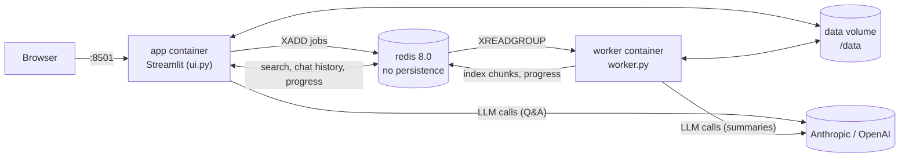
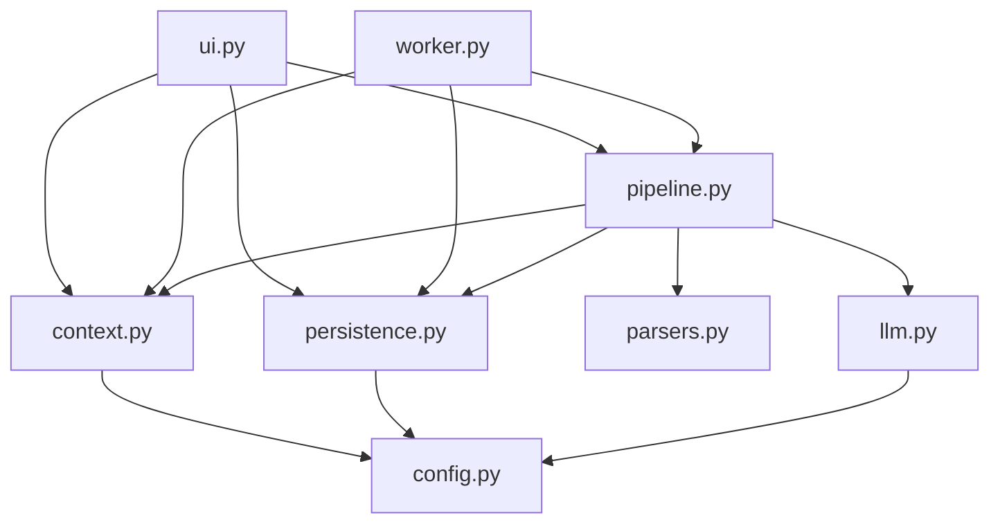
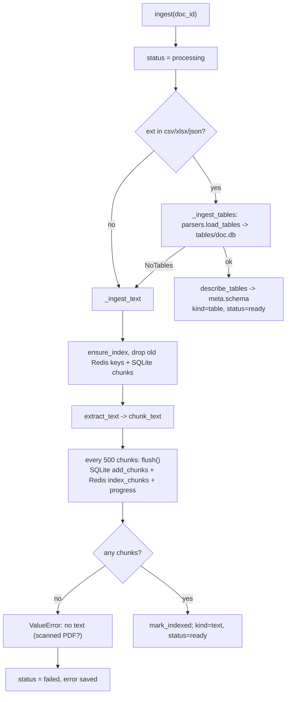
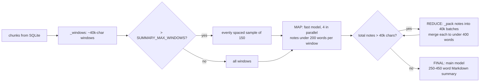
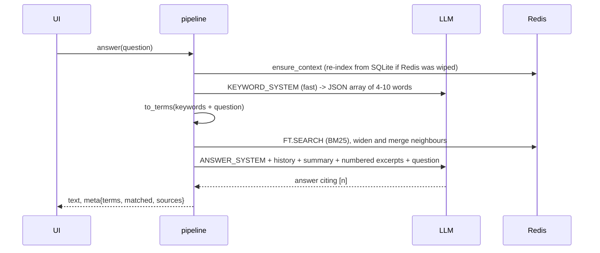

# Code Guide: Document Q&A POC

A walkthrough of how the source code works, module by module, with the main
request flows traced end to end. The README covers how to run the app; this file
covers how it works inside.

---

## 1. The big picture

You upload a file of up to 50 MB. The app can **summarise** it and **answer
questions** about it without ever sending the whole file to the LLM.

It does this in one of two ways, depending on what the file contains:

| File kind | How it is stored | How a question is answered |
|---|---|---|
| **Text** (PDF, DOCX, TXT, HTML, free-form JSON) | Split into ~1,200-char *chunks*, saved in SQLite, full-text indexed in Redis | Keyword (BM25) search finds the best chunks; the LLM answers from those |
| **Table** (CSV, XLSX, record-shaped JSON) | Every row loaded into a per-document SQLite database | The LLM writes a `SELECT`, the app runs it read-only, and the LLM answers from the result |

### Runtime components (docker-compose.yml)



- **app**: the Streamlit UI. Saves uploads, queues jobs, and answers questions
  **synchronously**, in the Streamlit process.
- **worker**: a loop that takes `ingest` and `summarize` jobs off a Redis
  stream. These are the slow jobs.
- **redis**: working context only: the search index, recent chat turns, the job
  queue and progress. It runs with `--save "" --appendonly no`, so a restart
  wipes it, which is intended.
- **`data` volume** (`/data`), shared by app and worker:
  - `app.db`: the main SQLite database, the **source of truth**
  - `uploads/<doc_id>.<ext>`: the original files
  - `tables/<doc_id>.db`: one SQLite database per tabular document

### The key design rule

> **SQLite is the source of truth; Redis is a disposable cache.**

Everything in Redis can be rebuilt from SQLite:
- Chunks and the index are rebuilt by `pipeline.ensure_context()` the next time
  someone asks a question.
- Chat history is reloaded by `pipeline._history()` from the `messages` table.

---

## 2. Module map and dependencies

```
app/
├── ui.py           Streamlit page (entry point of the app container)
├── worker.py       Job loop (entry point of the worker container)
├── pipeline.py     Ingest / summarise / answer  ← the core logic, start here
├── parsers.py      File readers, chunking, table loading, guarded SQL
├── context.py      Everything Redis
├── persistence.py  Everything SQLite (app.db)
├── llm.py          The single LLM call wrapper
└── config.py       All settings (env-overridable)
```



`pipeline.py` is the only module that combines the others. `parsers.py`,
`context.py`, `persistence.py` and `llm.py` don't import each other, so each one
can be read and replaced on its own.

> Note: modules import each other as top-level names (`import config`), not as
> `app.config`. This works because both entry points run from inside `app/`
> (`streamlit run app/ui.py`, `python app/worker.py`), which puts `app/` on
> `sys.path`.

---

## 3. Module by module

### 3.1 `config.py`: settings

Plain module-level constants, each read from an env var with a default.

| Group | Setting | Default | Used for |
|---|---|---|---|
| Paths | `DATA_DIR`, `SQLITE_PATH`, `UPLOAD_DIR`, `TABLE_DIR` | `/data/...` | Where files live |
| Redis | `REDIS_URL` | `redis://redis:6379/0` | |
| Upload | `MAX_UPLOAD_MB`, `ALLOWED_EXT` | 50, 8 extensions | Must match `.streamlit/config.toml` `maxUploadSize` |
| LLM | `LLM_PROVIDER`, `LLM_MODEL`, `LLM_FAST_MODEL` | anthropic / sonnet / haiku | The "fast" model does the bulk work (section notes, keywords) |
| Retrieval | `CHUNK_CHARS`, `TOP_K` | 1200, 6 | Chunk size and hits per question |
| Summary | `SUMMARY_WINDOW_CHARS`, `SUMMARY_MAX_WINDOWS`, `SUMMARY_CONCURRENCY` | 40000, 150, 4 | Map-reduce summary sizing and cost cap |
| Chat | `HISTORY_TURNS`, `CHAT_TTL_SECONDS` | 6, 24 h | How much conversation is sent back to the model |
| SQL | `SQL_MAX_ROWS`, `SQL_TIMEOUT_SECONDS` | 200, 15 | Guard rails for text-to-SQL |

### 3.2 `llm.py`: the single model call

```python
complete(system, messages, fast=False, max_tokens=2000) -> str
```

- `_client()` is cached with `lru_cache`, so only one SDK client is created per
  process. It is the Anthropic client by default, or the OpenAI client when
  `LLM_PROVIDER=openai` (which also covers any OpenAI-compatible endpoint
  through `OPENAI_BASE_URL`). Both use `max_retries=5`, so rate limits and
  transient errors are retried by the SDK.
- `fast=True` switches to `LLM_FAST_MODEL`.
- For Anthropic, it joins all `text` blocks of the reply. For OpenAI, the system
  prompt goes first in the message list, and **`max_tokens` is not passed**.
- To add a provider, add a branch to this one function.

### 3.3 `persistence.py`: SQLite (`app.db`)

The durable record. `connect()` is a context manager that opens a connection
with `row_factory=Row`, wraps the work in a transaction (`with conn:`), and
always closes the connection. `init()` creates the directories, turns on **WAL
mode** (because the app and the worker write to the same file concurrently),
and runs the schema.

**Schema**

| Table | Key columns | Notes |
|---|---|---|
| `documents` | `id` (uuid hex), `filename`, `ext`, `size_bytes`, `kind`, `status`, `error`, `n_chunks`, `n_chars`, `meta` (JSON) | `kind` = `text` or `table`; `status` = `queued → processing → ready \| failed`; for tables `meta` holds `{"tables": [...], "schema": "..."}` |
| `chunks` | PK `(doc_id, seq)`, `loc`, `text` | `loc` is e.g. `p.12` for PDFs, otherwise empty |
| `summaries` | PK `doc_id`, `status`, `summary`, `coverage`, `error` | `status` = `queued → running → done \| failed`; written as an upsert |
| `messages` | autoincrement `id`, `doc_id`, `role`, `content`, `meta` (JSON) | The full chat history; `meta` stores the sources or SQL behind an answer |

Helpers worth knowing:
- `update_document(doc_id, **fields)` builds `SET a=?, b=?` from keyword
  arguments, and JSON-encodes `meta` if a dict is passed.
- `iter_chunks(doc_id)` streams chunks in order, 1,000 at a time, using keyset
  pagination (`seq > last`). It opens a new connection per batch, so memory and
  lock time stay small even for a 50 MB document.
- `get_messages(doc_id, last=N)` returns the last N messages. It fetches all of
  them and slices in Python.

### 3.4 `context.py`: Redis

The module docstring lists the key layout:

| Key | Type | Purpose | Lifetime |
|---|---|---|---|
| `chunk:{doc}:{seq}` | Hash `{doc_id, seq, loc, text}` | Indexed by RediSearch index `idx:chunks` | Until the document is deleted or Redis restarts |
| `indexed:{doc}` | String | Marker meaning "this doc's chunks are in Redis" | Same |
| `chat:{doc}` | List of JSON turns | Last `2 × HISTORY_TURNS` messages | 24 h TTL |
| `progress:{doc}` | Hash `{stage, done, total}` | Live progress shown in the UI | 1 h TTL |
| `jobs` | Stream, consumer group `workers` | Job queue | |

**Connection:** `client()` uses `protocol=2` (RESP2), so `FT.SEARCH` returns a
flat list `[total, key1, key2, ...]` that is easy to parse.

**Index:** `ensure_index()` runs
`FT.CREATE idx:chunks ON HASH PREFIX 1 chunk: SCHEMA doc_id TAG seq NUMERIC text TEXT`
and ignores "already exists". Redis 8 includes the query engine, so no module
needs to be installed. Every hash whose key starts with `chunk:` is indexed
automatically when it is written.

**Search, the core of text Q&A:**

1. `to_terms(texts)` lowercases the text, keeps only alphanumeric words (`[^\W_]+`),
   drops one-letter words and stopwords, removes duplicates, and keeps at most
   16. This also makes the terms **safe to put into a query string**, because no
   query-syntax characters survive.
2. `_hits()` runs
   `FT.SEARCH idx:chunks "@doc_id:{<doc>} @text:(t1|t2|...)" NOCONTENT LIMIT 0 k DIALECT 2`.
   This is an OR of the terms, scoped to one document, ranked by BM25, and
   returns only the keys, from which it parses the `seq` numbers.
3. `search()` widens each hit to its neighbours (`seq-1, seq, seq+1`), fetches
   them in one pipeline, and **merges consecutive chunks** into continuous
   passages. If nothing matched, it falls back to the first `k` chunks (the
   opening of the document) and returns `matched=False`.

**Other helpers:** `index_chunks` (pipelined `HSET`s), `drop_document` (`SCAN`
plus `UNLINK` in batches of 500, then deletes the marker, chat and progress
keys), `get_history` / `set_history` / `append_turn` (chat list kept at the last
`2 × HISTORY_TURNS` entries via `LTRIM`, with the TTL refreshed),
`enqueue`, `set_progress` / `get_progress`.

### 3.5 `parsers.py`: files to text or tables

**Text side**

- `extract_text(path, ext)` is a generator of `(loc, text)` segments:
  - **PDF** (pypdf): one segment per page with `loc="p.N"`. A page that fails
    to extract becomes empty text instead of failing the whole document.
  - **DOCX**: paragraphs and tables in document order. Table rows are rendered
    as `cell | cell | cell`.
  - **HTML**: BeautifulSoup with lxml. `script/style/noscript/template/svg` are
    removed, then the text is joined with newlines.
  - **JSON** (non-tabular): pretty-printed, so the structure becomes searchable
    text.
  - **TXT and anything else**: decoded as UTF-8 (BOM-aware), falling back to
    Latin-1.
- `chunk_text(text, size)` normalises whitespace, then cuts pieces of about
  `size` characters. It prefers to cut at a newline, otherwise at a space, but
  only in the second half of the window, so pieces never get too small. Chunks
  never cross a PDF page boundary, because chunking runs per segment.

**Table side**

- `load_tables(path, ext, out_db)` dispatches to a loader. It raises `NoTables`
  when a JSON file isn't record-shaped, and the pipeline then falls back to
  treating it as text.
  - `_load_csv`: sniffs the encoding and the delimiter (`, ; \t |`) from the
    first 64 KB, then streams the file through pandas in 50k-row chunks into a
    table named `data`.
  - `_load_xlsx`: openpyxl in read-only mode. Each sheet becomes a table, the
    first non-empty row is the header, and rows are inserted 10k at a time.
    Non-primitive cells such as dates are stored as strings.
  - `_load_json`: either a top-level list of objects (table `data`) or a dict
    whose values are lists of objects (one table per key). Records are
    flattened with `json_normalize(max_level=2)`, nested lists and dicts become
    JSON strings, and columns that only appear in later batches are added with
    `ALTER TABLE`.
  - `_ident` / `_idents` turn arbitrary headers into safe, unique, lowercase
    SQL identifiers (`Total Sales ($)` becomes `total_sales`; duplicates get
    `_2`, `_3`; a leading digit gets a prefix).
- `describe_tables()` builds the **schema text given to the LLM**: row count,
  columns with types inferred from 3 sample rows, and the sample rows
  themselves.
- `profile_tables()` builds **per-column statistics** used for the summary:
  filled, distinct, min, max, mean (numeric values only), and the top 5 values
  when a column has 30 or fewer distinct values. At most 40 columns per table
  are profiled.
- `run_sql(db_path, sql, max_rows, timeout_s)` is the **guarded executor**:
  1. Strips the trailing `;`, rejects any remaining `;` (one statement only),
     and requires the statement to start with `SELECT` or `WITH`.
  2. Opens the database with `mode=ro`, so writes are impossible at the file
     level whatever the SQL says.
  3. Sets a progress handler that aborts the query after `timeout_s`, which is
     reported as `TimeoutError`.
  4. Fetches `max_rows + 1` rows to detect truncation.

### 3.6 `pipeline.py`: the three operations

#### Ingest (worker job `ingest`)



Ingest streams: text is extracted page by page and written in batches of 500,
so a 50 MB file is never held in memory as a whole list of chunks. On any
exception the document is marked `failed` with the error (cut to 500 chars), and
the exception is re-raised so the worker logs it.

#### Summarise (worker job `summarize`)

**Table documents**: `profile_tables` statistics plus the schema go into **one**
LLM call (`TABLE_SUMMARY_SYSTEM`). Coverage: "Based on statistics computed over
every row."

**Text documents** use **map-reduce**:



- A document with a single window skips map-reduce: it gets one `FINAL_SYSTEM`
  call on the raw text.
- **Sampling** (the cost guard): with `cap` windows out of `total`, it picks
  indices `round(i * (total-1) / (cap-1))`, so the first and last windows are
  always included. The `coverage` string tells the user what percentage was
  read.
- The map step uses a `ThreadPoolExecutor` and `as_completed`, but writes each
  note into its original slot (`notes[futures[fut]]`), so the **order of the
  document is kept**. Progress is updated after every window.
- The reduce loop repeats until the notes fit in one prompt.

#### Answer (synchronous, in the UI process)

`answer(r, doc_id, question)`:

1. `_history()` loads recent turns from Redis. If the key has expired, it
   reloads them from SQLite and writes them back to Redis. Leading `assistant`
   turns are dropped so the history always starts with `user`, which the
   Anthropic API requires.
2. It branches on `doc.kind`:

**Text path: `_answer_text`** (2 LLM calls)



- Keyword expansion lets the model resolve "it" or "that" from the conversation
  and add synonyms. If that call fails or returns bad JSON, the words of the
  question are used on their own.
- The finished summary, if there is one, is included as global context, so
  overview questions can be answered even when retrieval is weak.
- If the search matched nothing, the prompt says so explicitly, and the system
  prompt tells the model to say it can't find the answer instead of guessing.

**Table path: `_answer_table`** (2 LLM calls, or 3 with a repair)

1. `SQL_SYSTEM` with the schema, history and question. The model replies with
   one SQL query in a ```sql block, **or** plain text if the question doesn't
   need the data. In that case the reply is returned as the answer.
2. `_extract_sql` takes the query out of the code block, and `run_sql` runs it.
3. **One repair attempt** if the query fails: the error is shown to the model,
   which writes a corrected query. If that also fails, the user gets a "try
   rephrasing" message along with the SQL and the error.
4. The result is rendered as a pipe-separated table (cells cut to 200 chars) and
   passed to `RESULT_SYSTEM`, which writes the final answer.
5. `meta` keeps the SQL, the columns and the first 50 rows for the UI.

Finally, both paths persist the turn: `messages` in SQLite (with `meta`) and
`append_turn` in Redis.

#### Delete and recovery

- `delete()` removes everything: the Redis keys, the SQLite rows in all four
  tables, the uploaded file, and the table database.
- `ensure_context()` re-indexes chunks from SQLite when the `indexed:{doc}`
  marker is missing, for example after a Redis restart.

### 3.7 `worker.py`: the job loop

1. Initialises SQLite, then waits until Redis answers `PING`.
2. Creates the consumer group `workers` on stream `jobs` (from id `0`, and
   creates the stream if needed) and creates the search index.
3. Loops on `XREADGROUP ... COUNT 1 BLOCK 2000` with the hostname as the
   consumer name, and dispatches through `HANDLERS = {"ingest": ..., "summarize": ...}`.
4. **Always `XACK`s** in `finally`, even when a job fails. Failures are already
   recorded in SQLite, so jobs are never retried.

Jobs run **one at a time** per worker, and parallelism only happens inside a
summary (4 threads). You can scale out with more worker containers: they share
the consumer group, so each job goes to only one of them.

### 3.8 `ui.py`: the Streamlit page

Streamlit reruns the whole script on every interaction, so the file reads top
to bottom as "render the current state":

1. **`setup()`** (`@st.cache_resource`, once per process): initialises the
   database, creates the Redis client, and makes sure the consumer group exists.
2. **Sidebar**:
   - Upload form: checks the size, creates a `uuid4().hex` id, writes the file
     to `uploads/`, inserts a `documents` row (`queued`), runs
     `enqueue("ingest")`, and selects the new document.
   - A radio list of documents with status icons, and a **Delete** button.
3. **Main panel**, a state machine on the selected document:
   - `queued`/`processing`: `watch_ingest()`, a `@st.fragment(run_every=2)` that
     polls the database every 2 s, shows the Redis progress, and runs
     `st.rerun()` when ingest finishes.
   - `failed`: shows the error.
   - `ready`: a caption with size and stats, then:
     - **Summary**: polls the same way with `watch_summary()` while running,
       renders it when done, otherwise shows a **Summarize** button that writes
       `summaries.status=queued` and enqueues the job. Summaries are therefore
       **on demand**, not automatic.
     - **Questions**: replays the full history from SQLite, then
       `st.chat_input` calls `pipeline.answer()` directly inside a spinner.
   - `show_answer_details()` adds expanders with the SQL, the result table and
     the passages used.
   - `md()` escapes `$` so that amounts like "$5 and $10" are not rendered as
     LaTeX.

---

## 4. Lifecycle of one document

```mermaid
stateDiagram-v2
    [*] --> queued: upload (ui.py)
    queued --> processing: worker picks up ingest
    processing --> ready: text chunked + indexed / rows loaded
    processing --> failed: exception (error stored)
    ready --> ready: Summarize (summary: queued→running→done|failed)
    ready --> ready: Ask question (synchronous in UI)
    ready --> [*]: Delete
    failed --> [*]: Delete
```



## 5. Cost per operation

| Operation | LLM calls |
|---|---|
| Ingest | 0 |
| Summary, table | 1 |
| Summary, short text (1 window) | 1 |
| Summary, long text | N map (fast) + a few reduce (fast) + 1 final; N ≤ `SUMMARY_MAX_WINDOWS` |
| Question, text | 2 (keywords on the fast model, answer on the main model) |
| Question, table | 2, or 3 when the SQL needs a repair |

---

## 6. Things to be aware of

These come from reading the code. Some are also listed in the README's "Limits"
section.

**Behaviour and robustness**
- **Stuck jobs:** if the worker dies in the middle of a job, the message is
  never acknowledged and is never claimed again (nothing calls
  `XPENDING`/`XAUTOCLAIM`), so the document stays `processing` for good.
- **No retries:** failed jobs are acknowledged and dropped. The user has to
  delete the document and upload it again (ingest), or press Summarize again
  (summary).
- **One queue for both job types:** a long summary (up to 150 windows) blocks
  every ingest queued after it unless you run more worker containers.
- **Q&A runs in the UI process:** each question blocks that Streamlit session
  for 2–3 model calls.
- **Delete has no confirmation step.**

**Retrieval**
- Search is keyword-only (an OR of terms, ranked by BM25), so paraphrased
  questions can miss. Vectors are the README's suggested next step.
- When nothing matches, the "opening of the document" is used as a fallback.
  That is often irrelevant, but the model is told about it.

**Tabular parsing edge cases**
- `run_sql` rejects any `;` inside the statement, including one inside a string
  literal such as `WHERE note = 'a;b'`. That is safe but can refuse valid
  queries.
- `_load_json` normalises column names itself instead of using `_idents`, so two
  keys that normalise to the same name (for example `a.b` and `a_b`) would
  collide.
- In XLSX files, cells beyond the header width are dropped.

**Provider and config**
- On the OpenAI path, `max_tokens` is ignored.
- Check that `LLM_MODEL` / `LLM_FAST_MODEL` are model IDs your provider
  accepts. The defaults in `config.py` and `.env.example` are
  `claude-sonnet-5-5` and `claude-haiku-4-5-20251001`.

**Security**
- There are no user accounts. Anyone who can reach port 8501 can see and delete
  every document.
- Text-to-SQL is protected in three layers: one statement that must start with
  SELECT/WITH, a read-only database file, and a time limit and row cap.
- The Redis query is safe from injection because `to_terms` keeps only
  alphanumeric words.

---

## 7. Where to start if you want to change something

| Goal | Where |
|---|---|
| Use a different LLM provider | `llm.py` → `complete()` |
| Support a new file type | `config.ALLOWED_EXT` + `parsers.extract_text()` (text) or `parsers.load_tables()` (data) |
| Add vector or semantic search | Add a `VECTOR` field in `context.ensure_index()`, embed chunks in `context.index_chunks()`, run a KNN or hybrid query in `context._hits()` |
| Change the prompts | The `*_SYSTEM` constants at the top of each section of `pipeline.py` |
| Retry or recover stuck jobs | `worker.py`: add `XAUTOCLAIM` for stale pending entries |
| Generate the summary automatically after ingest | At the end of `pipeline.ingest()`: `db.set_summary(..., "queued")` + `context.enqueue(r, "summarize", doc_id)` |
